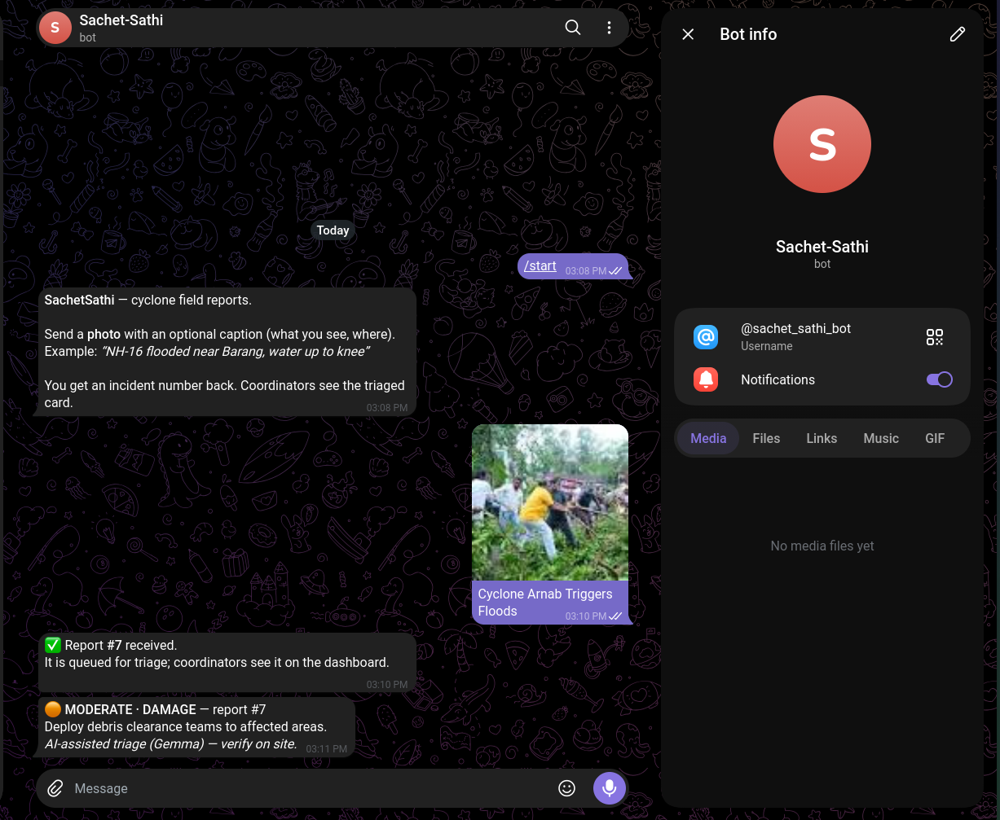
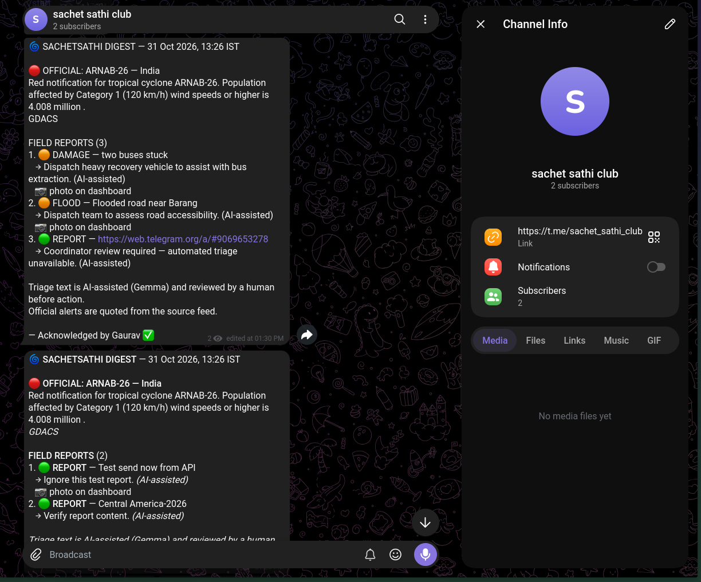

# 🌀 SachetSathi — ସଚେତ ସାଥୀ

> **A cyclone field assistant for coastal Odisha.** Live official alerts from GDACS / NDMA / IMD, Telegram field reports, Gemma AI triage into strict-JSON cards, and an offline-capable PWA.

<p align="center">
  
</p>

<p align="center">
  <a href="#-status"></a>
  <a href="#"></a>
  <a href="#"></a>
  <a href="#"></a>
  <a href="#"></a>
  <a href="#"></a>
  <a href="assets/SachetSathi_v2.pptx"></a>
</p>

---

## 📌 What's live right now

| Phase | Feature | State |
|---|---|---|
| **P0** | FastAPI scaffold, health endpoint, public repo | ✅ |
| **P1** | GDACS RSS alerts → `/api/alerts` + fixture fallback | ✅ |
| **P2** | Telegram ingest (`@sachet_sathi_bot`) + digest (`@sachet_sathi_club`) | ✅ |
| **P3** | Gemma triage → strict-JSON cards (`gemma-4-26b-a4b-it`) | ✅ |
| **P4** | Offline PWA (`sw.js`, `manifest.json`, IndexedDB queue) | ✅ |
| P5 | Deploy to Cloud (Render / DigitalOcean) | ⬜ (in progress / ready) |
| P6 | Pitch freeze, submission, video | ⬜ (ready) |

Built for **MLH Hacktoberfest Hack Day — Bhubaneswar × DatrixLabs**, Oct 31 2026.

---

## 🚀 Quick start (30 seconds)

```bash
# 1. Clone
git clone https://github.com/Gaurav5189/sachet-sathi
cd sachet-sathi

# 2. Configure secrets (never commit .env!)
cp .env.example .env
# Edit .env: add TELEGRAM_BOT_TOKEN, TELEGRAM_CHANNEL_ID, GEMINI_API_KEY

# 3. Start (podman OR python server)
podman compose up --build          # container
# OR directly:
.venv/bin/python -m uvicorn app.main:app --host 0.0.0.0 --port 8000

# 4. Verify
curl http://localhost:8000/api/health
```

**PWA:** open `http://localhost:8000/` → install from browser → works offline.

---

## 🏗 Architecture at a glance

```
OFFICIAL FEEDS                    FIELD REPORTERS             COMMUNITY
├─ GDACS RSS (live)               ├─ Telegram bot             ├─ Telegram channel
├─ IMD bulletin (future)          │  photo + caption          │  digest broadcast
└─ Fixture snapshot               │  ──→ DB (pending)         │  Acknowledge ✅ / Escalate ⏰
         │                        │        ↓                  │
         ▼                        │   Gemma triage             ▼
    FastAPI (DO App Platform)     │   ──→ strict JSON card     Digest post
    ├─ alerts.py                  │        ↓                   (every 5 min event trigger)
    ├─ ingest.py (poll)           │   ack + card reply         │
    ├─ triage.py                  │                            │
    ├─ digest.py                  └──→ PWA dashboard           │
    ├─ api.py                       (offline, IndexedDB)       │
    └─ reports.py (PWA flush)                                  │
```

Every external call has a timeout + retry + fallback. No bare `except`. AI outputs data only — it never sends messages, never mutates the DB, and never parses feeds. See [DOCS/ARCHITECTURE.md](DOCS/ARCHITECTURE.md) and [DOCS/RULES.md](DOCS/RULES.md).

---

## 📡 Telegram — how the two flows work

### Reports in → `@sachet_sathi_bot`
Any user sends a photo (+ caption) directly to the bot. The bot:
1. Stores the incident (idempotent on `tg:<chat>:<message>`)
2. Replies with an ack ✅
3. Runs Gemma triage in the background (one retry, 25 s timeout)
4. Sends back a structured card with severity, category, Odia summary, next action, priority

The bot identity is verified live:
```bash
curl http://localhost:8000/api/telegram/bot
# → {"username":"sachet_sathi_bot","name":"Sachet-Sathi","deep_link":"https://t.me/sachet_sathi_bot"}
```

> 📸 **Proof — bot ingest + triage card**: user sends photo → bot replies with incident number + ack → background triage returns structured card (`MODERATE · DAMAGE`, `priority 2`, Odia summary, action) → user sees full card in chat.
> 

### Digest out → `@sachet_sathi_club`
The server builds a digest (freshest official alert + top triaged reports) and posts it to the configured channel. It includes inline buttons:
- **Acknowledge ✅** — edited in place, keyboard removed
- **Escalate ⏰** — edited in place, audit trail saved in DB (`digest_decision:<msg_id>`)

The digest is triggered **event-based** (new severe incident OR new relevant official alert, rate-limited to once every 5 minutes) and can also be triggered manually:
```bash
curl -X POST http://localhost:8000/api/digest
```

> 📸 **Proof — digest in `@sachet_sathi_club`**: official ARNAB-26 alert (Red), 3 field reports, Acknowledge button visible. Bot (`Sachet-Sathi`) promoted admin.
> 

---

## 🧠 AI disclosure & limitations

- **Model**: `gemma-4-26b-a4b-it` (open weights, via Google Gemini API). Confirmed live in the model list.
- **Usage**: Only formats reporter photo + caption into a `TriageCard` (`severity`, `category`, `odia_summary`, `next_action`, `priority`).
- **No decisions**: It does not fetch, parse or invent official data. It never sends messages or touches the DB.
- **Safety**: If the model returns bad JSON twice, a deterministic keyword classifier takes over. The card is marked `triage=fallback` so a human reviews it.
- **Latency**: 6–17 s per call (measured). The reporter is acked before triage starts, so slow models never delay the acknowledgement.
- **Every call is logged** (`ai_calls` table: model, latency, ok/error) for full audit.
- **Odia output verified**: Odia script output confirmed live (`ଓଡ଼ିଆ` text produced correctly).

Limitations:
- No local on-device inference (network model only — documented trade-off)
- No user accounts / login (Telegram user ID is identity)
- No push notifications (Telegram channel does the pushing)
- Digest requires the bot to be an admin of the target channel/group

---

## 📱 PWA — offline capability

- **Shell**: `index.html` + `style.css` + `app.js` (vanilla JS, no build step, no bundler)
- **Service worker**: `sw.js` precaches the app shell and safety pack; network-first for `/api/*`, falling back to cached responses
- **IndexedDB**: `kv` (cached alerts, incidents, language, pack) + `queue` (offline reports)
- **Safety pack** (`/api/safetypack`): emergency numbers (112, 108, 101, 1070, 1078, 104), do/don'ts, go-bag checklist — in English and Odia (`ଓଡ଼ିଆ`). Numbers are verified public helplines; shelter locations are NOT included (they change per district and must be confirmed locally) — clearly stated in the pack.
- **Offline report flow**:
  1. Open `/` → page loads (cached or live)
  2. Tap `+` → fill caption (+ optional photo) → **Save report** (saved to IndexedDB, no network needed)
  3. Toggle online → tap **Send now** → `POST /api/report` (idempotent on `client_id`) → new incident row created → background triage runs

The PWA works with `navigator.serviceWorker.register('/sw.js')`. It is installable (`manifest.json`) and uses `display: standalone`.

---

## 🧪 Testing (51 tests green)

```bash
.venv/bin/python -m pytest -q
# 51 passed, 1 warning
```

Key test coverage:
- `test_api.py`: health, bot identity (`getMe` verified live: `sachet_sathi_bot` id `9069653278`), capability split, 404/503 contracts
- `test_alerts.py`: GDACS RSS parser, fixture fallback
- `test_ingest.py`: FakeTelegram, idempotency, outbox, poll loop survives failures, callback ack/edit/remove-keyboard
- `test_digest.py`: digest preview (no send), button keyboard, outbox flush
- `test_triage.py`: strict `TriageCard`, synonym mapping (`high` → `severe`), array unwrap, transport retry (simulated 500), fallback classification

---

## 🏗 Deploy (P5 — ready)

```bash
# Container (Docker-compatible, runs with podman)
podman compose up --build

# Or direct server (during dev / demo)
.venv/bin/uvicorn app.main:app --host 0.0.0.0 --port 8000

# Health check
curl http://localhost:8000/api/health
```

The Dockerfile (`python:3.11-slim`) is single-stage, no build step. `HEALTHCHECK` is defined but ignored under OCI format (harmless warning). `.env` is loaded by a stdlib parser (`app/config.py`) — no `python-dotenv` dependency.

---

## 📂 Project structure

```
sachet-sathi/
├── .env              # secrets — NEVER committed
├── .env.example      # template with comments stripped by loader
├── .agents/MEMORY.md # living log of decisions, known issues
├── DOCS/              # PRD.md, ARCHITECTURE.md, RULES.md, PHASES.md, DESIGN.md
├── app/
│   ├── main.py        # FastAPI factory + lifespan (poller start/stop)
│   ├── config.py      # stdlib .env loader + Settings
│   ├── models.py      # sqlite schema + helpers (WAL, idempotent keys)
│   ├── alerts.py      # GDACS RSS parser + fixture fallback
│   ├── telegram.py    # raw Bot API client (httpx, timeout/retry)
│   ├── ingest.py      # poll loop + update handling + callback edit
│   ├── digest.py      # digest text + Acknowledge/Escalate buttons
│   ├── triage.py      # Gemma strict-JSON contract + fallback
│   ├── reports.py     # PWA POST /api/report (idempotent queue)
│   └── api.py         # REST routes
├── web/               # PWA (vanilla JS, no build)
│   ├── index.html     # shell
│   ├── style.css      # DESIGN.md tokens (dark, accessible)
│   ├── app.js         # offline model, IndexedDB, flush, filters
│   ├── sw.js          # precache + network-first API
│   ├── manifest.json  # installable, standalone
│   ├── safety-pack.json  # EN + Odia emergency info
│   └── icon-*.png     # copied from favicon_io/
├── fixtures/          # gdacs-sample.{json,xml}
├── tests/              # 51 tests
├── Dockerfile         # single-stage, COPY web ./web
├── docker-compose.yml
├── scripts/
│   └── snapshot_gdacs.py
└── LICENSE (MIT)
```

---

## ⚠️ Limitations

- **Model inference is remote only** (no on-device Gemma). During network loss, triage pauses; the fallback classifier continues.
- **Digest requires the bot to be a channel/group admin**; without it, `POST /api/digest` returns 409 (`channel_not_configured`).
- **No automated cron digest** — event-based trigger (severe incident / relevant alert) with a 5-minute rate limit; manual `POST /api/digest` always works.
- **No user accounts / login** — Telegram user ID is identity; no moderation features.
- **PWA requires modern browsers** (IndexedDB + ServiceWorker + `navigator.serviceWorker`).

---

## 🏆 MLH / Hackathon submission

**Presentation / Pitch Deck:**
- 📊 **[Download Pitch Deck (SachetSathi_v2.pptx)](assets/SachetSathi_v2.pptx)** — Full presentation deck with problem statement, architecture, Gemma 4 triage flow, and impact breakdown.
- 📄 **[Pitch Architecture & Script Guide (explanation.md)](explanation.md)** — Slide-by-slide script and judging alignment notes.

**Tracks:**
- **Best Open-Source AI Project** (DigitalOcean) — open-weight Gemma load, no proprietary model (main for this project)
- **Best Use of Gemma 4** — `gemma-4-26b-a4b-it` confirmed live, vision + Odia output verified

**What judges see in <2 minutes:**
1. `podman compose up --build` → `curl /api/health` → live
2. `GET /api/alerts` → real ARNAB-26 alert (Red, India)
3. `POST /api/report` → incident created + triaged (+ photo saved)
4. `GET /api/incidents` → strict JSON card (`severity`, `category`, `odia_summary`, `next_action`)
5. PWA at `/` → works offline (`sw.js` registered, `safety-pack.json` loaded)

---

## 📜 License

MIT — see [LICENSE](LICENSE). The `telegram-send-demo/` reference repo (local only, never committed, listed in `.gitignore`) is used only as a plumbing pattern reference.

---

*Built with urgency for the people of coastal Odisha. Verify every number before relying on it in an emergency.*
